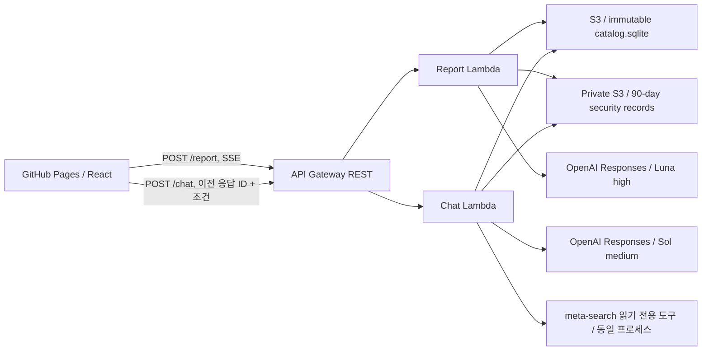

# Review Catalog Platform Demo

고정된 모니터 9개의 객관 속성과 실제 리뷰를 함께 비교하는 공개 포트폴리오 데모입니다. 기존 `review-catalog-platform`의 상시 EC2·Airflow·PostgreSQL 운영을 두 개의 요청 기반 Lambda와 GitHub Pages로 대체합니다.

- 웹: https://experience-driven-product-catalog.github.io/review-catalog-platform-demo/
- API: https://mbtxcknt19.execute-api.ap-northeast-2.amazonaws.com/prod
- React 19 · TypeScript · Tailwind CSS 4 · GitHub Pages
- Python 3.12 · FastAPI · AWS Lambda Web Adapter · API Gateway Regional REST streaming
- S3의 해시가 고정된 SQLite 한 파일, 읽기 전용 `/tmp` 캐시
- OpenAI Responses API: 추출 `gpt-6-luna` / `high`, 채팅 답변 `gpt-6.1-sol` / `medium`

## 프로젝트 경계



Lambda는 실행이 끝나면 응답을 종료합니다. 다음 요청이 같은 실행 환경에서 처리된다는 가정을 하지 않습니다. EC2, PostgreSQL, DuckDB, Airflow, 임베딩 모델, 재군집화 서버는 배포하지 않습니다. 기존 EC2 리소스의 종료·삭제는 이 프로젝트의 배포에 포함되지 않습니다.

## 데이터 원본

상품 데이터는 기존 **모니터 9개·리뷰 1,609개·Opinion Units 4,828개**를 유지합니다. 최신 meta-search의 실제 상품/키보드 데이터는 가져오지 않습니다. 기존 플랫폼의 DuckDB·PostgreSQL도 사용하지 않습니다.

- 보존 원본: `data/source/keyboard_search.sqlite` (기존 배포의 고정 스냅샷)
- 실행 데이터: `data/catalog.sqlite` — meta-search 네이티브 스키마로 변환
- 출처·건수·SHA-256·가상 판매 정책: `data/manifest.json`
- 상품 ID는 정수로 변환하고 `demo_product_ids`에 기존 slug와의 대응을 보존합니다. 보고서 API는 이전 slug도 허용합니다.
- 객관 속성은 `category_attributes`/`product_attributes` EAV로 이전합니다. `screen_size`, `refresh_rate` 등 새 키와 기존 보조 키를 가이드에서 조회할 수 있습니다. 원래 값·미확인·명시적 false를 유지합니다.
- 리뷰 본문, Opinion Unit 발췌·의견·감성 및 기존 군집 대표명은 그대로입니다. 원래 표현 ID만 meta-search의 `av_`/`sv_` 규칙(NFKC·공백 정리·casefold 기반 결정적 ID)으로 변환합니다. 재군집화하지 않습니다.
- 원본 상품 행은 `demo_source_products`에 보존하고 상세 Markdown은 `products.details_md`에 넣습니다. 최신 meta-search의 등록 작업 이력은 포함하지 않습니다.
- 사용자 입력은 카탈로그에 반영하지 않으며 기존 비공개 S3 보안 기록 정책을 유지합니다.

재현:

```bash
# 원본 meta-search에 설치된 MCP/Pydantic으로 도구 시그니처만 내보냅니다.
../meta-search/.venv/bin/python scripts/sync_meta_search.py --source ../meta-search
uv run python scripts/build_catalog.py
```

변환기는 원본을 읽기 전용으로 열고 별도 파일을 생성합니다. 실행 중 상품 등록·수집·재군집화·임베딩·웹 조사는 하지 않습니다. Lambda는 새 해시의 고정 SQLite만 읽습니다.

### 가상 판매 정보

`offers`에는 상품별 3개씩 **27개 가상 판매처**를 넣습니다. 기존 가격 범위를 기준으로 소폭 차이를 둔 판매가, 배송비 0/2,500/3,000원과 미확인, 배송일 1~5일과 미확인, 판매 중/품절/단종/미확인 상태를 구성합니다. 가상 판매가는 실측 판매가나 실제 재고가 아닙니다. 오래된 상품 상세 문서의 과거 판매 정보와 구분합니다.

판매자·판매 사이트·가격·배송비·배송일·재고·URL·기준일을 `get_offers`로 조회할 수 있습니다. `offer_filter`는 같은 판매처 행이 모든 조건을 충족해야 통과합니다. `max_price`는 배송비 제외 상품가이며, 배송비 포함 금액은 `total_price`로 별도 제공됩니다. 판매 중 조건은 명시적으로 요청할 때 적용합니다.

메타데이터는 `sales_data_policy.synthetic=true`를 유지합니다. 사용자에게는 최초 채팅 진입 시 AI HUB의 [속성 기반 감성 분석 데이터셋](https://aihub.or.kr/aihubdata/data/view.do?currMenu=115&topMenu=100&aihubDataSe=data&dataSetSn=71603)에서 추출한 모니터 9개와 과거/더미 판매 정보라는 안내를 확인하게 합니다. 이 확인 상태는 현재 페이지 메모리에만 유지되고 새로고침 시 다시 안내합니다. 이후 판매처 이름과 답변에는 `(데모)`·`가상 판매처` 접두어를 붙이지 않습니다. 사용자가 실제 정보인지 질문하면 한계를 설명하며 새로 실시간 조회했다고 주장하지 않습니다. `last_checked_at=2026-10-14T00:00:00Z`는 **가상 데이터 기준일**이지 실제 확인일이 아닙니다. URL은 `https://www.coupang.com.invalid/vp/products/900000000100`과 같은 형태이며 실제 구매 페이지로 연결되지 않습니다. 인터넷 조사는 수행하지 않았습니다.

## 검색 도구와 대화

`backend/vendor/meta_search`에 최신 meta-search의 검색 모듈과 원본 해시를 보존합니다. 원본 `server.py`를 실행하지 않고 함수 시그니처에서 읽기 전용 도구 9개의 스키마를 내보냈습니다. 등록·등록 상태 조회 도구는 노출하지 않습니다.

`get_search_guide`, `search_products`, `compare_products`, `get_product_details`, `search_product_docs`, `find_review_attributes`, `list_review_states`, `get_review_evidence`, `get_offers`

별도의 상시 MCP 서버를 만들지 않고, Responses API function calling을 동일한 도구 함수로 전달합니다. 통신·읽기 전용 SQLite 연결을 조정하고 상세 정보/가이드의 주요 속성 집계를 원래 표현 기준으로 유지합니다. 검색 결과에는 UI를 위한 결과 수·조건 카드 필드를 추가합니다. 조건 카드는 객관·체감·판매 유형만 사용하며 요청문·해석·결과 수를 ‘검색’ 유형으로 노출하지 않습니다. 제한 없음 행은 숨기고, 명시한 필터·정렬·리뷰 근거 검색에 각각 filter/sort/search 메소드를 부여해 아이콘과 `속성: 값`으로 표시합니다. 객관 필터, 원래 속성/상태 선택, 리뷰 단위 집계, Wilson 점수, UNKNOWN 처리 및 조건 미충족 정책은 기존 MCP를 따릅니다.

- 필수 조건은 AND, 명시한 속성 선택 절은 OR입니다.
- 실제 원래 표현 ID를 조회한 뒤 사용합니다. 같은 군집이라는 이유만으로 모든 표현을 동일시하지 않습니다. 모든 체감 도구의 선택자에 비어 있지 않은 `aspect_variant_ids`가 필수이며 군집 전체 선택은 거부됩니다. 서로 다른 원래 표현의 명시적 OR 검색은 가능하지만 자동 동의어 통합은 하지 않습니다.
- 일치 상품이 없으면 없다고 답하고, 자동으로 조건을 완화하지 않습니다.
- 상반 리뷰와 근거 부족을 제품의 결함·미지원과 구분합니다.
- 판매 정보는 전부 데모 가상 데이터이며 실시간 또는 실제 확인 정보가 아닙니다.

Frontend는 한 대화의 메시지, 적용 조건, 재호출용 전체 검색 인자, `previous_response_id`, 서명된 continuation을 **메모리**에만 보관합니다. 새 대화는 확인 창 뒤 이를 모두 초기화하고 진행 중 응답을 무시합니다. localStorage, sessionStorage, IndexedDB를 사용하지 않습니다. 페이지를 닫거나 새로고침하면 화면에서 복구할 수 없습니다. 서버의 보안 기록은 삭제되지 않으며 90일 보관 정책이 적용됩니다.

**OpenAI 측 저장과 앱 저장은 구분됩니다.** 채팅은 사용자가 지정한 `previous_response_id` 방식으로 문맥을 연결하기 위해 `store=True`를 사용합니다. 앱의 새 대화 버튼은 이전 ID를 더 이상 전송하지 않으며, OpenAI 측 저장 데이터를 삭제하는 기능은 아닙니다. 리뷰 추출은 `store=False`입니다. OpenAI의 API 데이터 처리 정책이 별도로 적용됩니다. 이 내용은 채팅 UI에도 표시합니다.

continuation에는 서버 발급 보안 기록용 대화/요청 ID, 만료 시간(24시간), 카탈로그 버전, 응답 ID와 적용 조건의 HMAC 서명이 포함됩니다. 클라이언트의 임의 응답 ID·조건 교체를 거부합니다. 카탈로그 버전이 달라지거나 연결이 만료되면 새 대화를 안내합니다. 모델 호출은 턴당 최대 10회, 도구 호출은 최대 16회로 제한합니다.

## 보안 기록 (`security-audit-v1`)

- 저장 위치: `s3://review-catalog-demo-audit-161088569936-ap-northeast-2/audit/v1/`
- 경로: `{chat|report}/{UTC YYYY/MM/DD}/{session UUID}/{request UUID}/{request|result|error}.json`
- 수집: 제출한 메시지/리뷰, 적용 조건, 답변, 보고서 JSON·Markdown·Opinion Units, 처리 시각, 모델/카탈로그 버전, 익명 대화 ID와 이전 요청 ID, 실패 코드.
- 미수집: IP, 쿠키, 인증 헤더, 서버 API 키, continuation 서명 토큰, OpenAI 응답 ID. 단, 사용자가 본문에 직접 적은 개인정보는 본문에 포함되므로 입력하지 않도록 화면에서 안내합니다.
- 모델 호출 전에 `request.json`을 저장합니다. 결과는 `result.json` 저장 성공 후에만 반환합니다. 초기 저장 실패 시 모델을 호출하지 않고, 결과 저장 실패 시 정상 결과를 반환하지 않습니다. 처리 예외는 민감한 오류 원문 대신 코드만 `error.json`에 기록합니다.
- 형식/크기 검증을 통과해 처리기에 진입한 제출 요청이 대상입니다. API Gateway/FastAPI가 먼저 거부한 요청, 전송하지 않은 초안, 스트리밍 진행 문구와 내부 도구 호출 전체는 저장하지 않습니다.
- 강제 종료·시간 초과·연결 중단 시에는 request만 남을 수 있습니다. 이는 미완료 요청이며 성공 기록으로 해석하지 않습니다. 기존 요청을 덮어쓰지 않고 재시도마다 새 UUID를 발급합니다.
- 서버가 서명한 대화 ID로 후속 턴을 연결합니다. 새 대화는 새 ID를 사용하고, 초기화/페이지 종료는 서버 기록이나 OpenAI 기록을 삭제하지 않습니다. 저장 전의 과거 대화는 소급 복구하지 않습니다.
- 90일 뒤 S3 Lifecycle 자동 삭제 대상이 됩니다. 실제 삭제는 비동기 처리이므로 정확히 90일 시점의 즉시 삭제를 보장하지 않습니다. [AWS 수명 주기 문서](https://docs.aws.amazon.com/AmazonS3/latest/userguide/lifecycle-expire-general-considerations.html)
- 공개 조회/다운로드 API와 프런트엔드 S3 접근 권한은 없습니다. 허가된 운영자만 AWS IAM 권한으로 조회하며, 해당 기록은 카탈로그 학습·재군집화·추천 통계에 반영하지 않습니다. 이 기록은 이용자 인증이나 공격 차단 기능을 대신하지 않습니다.
- 버킷은 스택 삭제 시 보존하되 수명 주기는 유지합니다. Lambda에는 종류별 prefix 추가 권한만 부여하며, 버킷 정책과 `If-None-Match: *`로 기존 객체 덮어쓰기를 막습니다. 객체 잠금 기반 영구 불변 보관은 아닙니다.

## 통합 보고서

별도 정적 보고서 페이지는 없습니다. 리뷰 입력 후 생성하는 **보고서**에 다음 내용을 포함합니다.

1. 추출된 Opinion Units와 연속 원문 발췌, Exact-match 결과
2. 기존 리뷰 감성의 최빈값과 일치·상충·판단 불가, 다른 상태 및 원문 근거
3. 입력된 부정 조건에 대한 대안 상품
4. 해당 상품의 기존 리뷰 요약: 주요 속성/상태, 언급률, 감성 분포, Wilson 구간, 대표 근거
5. 부정·논쟁 속성, 체감 프로필이 유사한 상품, 기존 약점의 대안

Exact-match는 meta-search의 원래 표현 ID 규칙(NFKC·공백 정리·casefold)으로 기존 **원래 속성 문자열**, 해당 속성에서 실제 관측된 **원래 상태 문자열**을 조회합니다. 하나의 원래 표현 ID로 결정되지 않으면 미해결입니다. 정규 ID와 대표명은 참고 정보로만 반환합니다. 상태가 null이면 상태를 만들어 내지 않습니다. 새 임베딩 후보, 유사 표현 매핑, 군집 생성은 없습니다. `전반적 상품 경험`은 비교에서 제외합니다. 추출된 발췌가 입력 리뷰의 연속 부분 문자열이 아니면 보고서를 반환하지 않습니다.

**모든 체감 비교는 `raw-expression-v1` 정책을 따릅니다.** 보고서의 언급 수·감성 분포·일치/상충·유사도·약점·대안 점수는 `aspect_variant_id`와 `state_variant_id`로 계산합니다. 리뷰당 원래 속성 또는 원래 속성/상태별 한 표를 사용합니다. 미상을 제외한 감성이 하나이면 해당 감성, 둘 이상이면 혼합, 전부 미상이면 미상입니다. 95% Wilson 구간과 상품 프로필 사전 강도 5, 근거 신뢰도, 기존 대안 점수(체감 유사도 25% + 효용 75%)를 새 SQLite 코드로 구현했습니다. 대안 점수는 일부 조건 근거를 허용하는 탐색용 순위이므로 **모든 필수 조건을 충족하는 검색 결과와 다릅니다.** 보고서에서 이 한계를 명시합니다.

비교 기준은 입력을 추가하지 않은 고정 카탈로그입니다. 마지막 등록 리뷰, 사용자 입력 이력, 재군집화 진단 및 실제 검사 없는 품질 보증 값은 제거했습니다. 보고서는 결정적 계산으로 작성하고 Markdown 다운로드를 제공합니다.

## 로컬 실행

```bash
uv sync --frozen
cp .env.example .env  # 이미 .env가 있다면 덮어쓰지 마세요.
CATALOG_PATH="$PWD/data/catalog.sqlite" PYTHONPATH=backend \
  uv run --env-file .env uvicorn demo.app:app --host 127.0.0.1 --port 8000 --no-access-log
```

다른 터미널:

```bash
npm ci --prefix frontend
VITE_API_URL=http://127.0.0.1:8000 npm run dev --prefix frontend
```

`http://127.0.0.1:5173/review-catalog-platform-demo/`에서 확인합니다. `.env`의 `SESSION_SIGNING_SECRET`은 충분히 긴 임의 값으로 설정합니다. AWS 배포 스크립트가 없으면 자동 생성합니다. 로컬 실행도 `.env`의 `AUDIT_BUCKET`과 해당 버킷 쓰기 권한이 있는 AWS 인증이 필요합니다. 저장소를 설정하지 않으면 `AUDIT_UNAVAILABLE`로 처리를 거부합니다. 저장소가 준비된 상태에서 자리표시자 키를 사용하면 두 생성 경로가 `API_KEY_REQUIRED`를 반환합니다. 가짜 AI 답변은 반환하지 않습니다.

## AWS 배포

```bash
aws login
uv run python scripts/package_lambda.py
uv run python scripts/deploy.py
uv run python scripts/smoke.py
```

`infra/template.py`에서 재현 가능한 CloudFormation을 생성합니다. 배포 결과는 무시된 `deployment.json`과 `frontend/.env.local`에 기록됩니다. 키는 `.env`에서 읽어 NoEcho 파라미터로 전달하며 명령 인자·출력·Git에 기록하지 않습니다.

- 스택: `review-catalog-platform-demo-storage`, `review-catalog-platform-demo`
- 리전: `ap-northeast-2`
- 함수: `review-catalog-platform-demo-report`, `review-catalog-platform-demo-chat`
- 각 512MB / 최대 300초 / provisioned concurrency 없음
- API Gateway: Regional REST, `STREAM`, 경로별 초당 1개 / burst 3 제한
- 카탈로그 S3: 퍼블릭 액세스 차단·암호화·버전 관리, Lambda는 해당 카탈로그 객체 읽기 권한 보유
- 보안 기록 S3: 별도 비공개 버킷, AES256 암호화, HTTPS 강제, 90일 수명 주기. Lambda는 종류별 prefix에 조건부 PutObject만 가능하며 읽기·삭제 권한 없음
- 애플리케이션 요청 본문/모델 출력과 API Gateway 실행 본문 로그 비활성화, 런타임 로그 보관 7일

현재 계정 동시 실행 한도 10개에서는 별도 예약 동시 실행을 설정할 수 없어 예약하지 않습니다. API 제한은 요청 속도를 줄이는 설정이며 월 비용 상한은 아닙니다. 기존 EC2와 별개로 Lambda·API Gateway·S3·OpenAI 사용량에 따라 과금됩니다.

API Gateway 일반 버퍼링 요청의 제한을 피하기 위해 공식 Lambda Web Adapter layer v30과 REST 응답 스트리밍을 사용합니다. JSON 결과와 진행 상태를 SSE로 전달하고 10초 heartbeat를 보냅니다. API 키가 없어도 배포·S3 로드·CORS·두 스트리밍 오류 경로는 검증할 수 있습니다.

## API 키가 준비되면

1. 로컬 `.env`의 `OPENAI_API_KEY` 자리표시자를 실제 키로 교체합니다. 채팅·로그에 키를 붙여 넣지 않습니다.
2. `uv run python scripts/update_api_key.py` — 두 Lambda 환경만 갱신합니다.
3. `uv run python scripts/smoke.py --live` — 2턴 대화의 조건 유지와 리뷰 보고서를 실제 API로 검증합니다.
4. `uv run python scripts/verify_audit.py` — 실제 2턴 대화·새 대화·보고서의 S3 저장, 세션 연결, 암호화·비공개·덮어쓰기 차단을 검증합니다. 조회는 운영자 AWS 인증으로 수행하며 내용을 출력하지 않습니다.

2026-10-11에 실제 키로 두 기본 모델의 호출, 2턴 채팅과 보고서 생성을 검증했습니다. 새 계정/키에서는 같은 smoke 테스트로 권한과 동작을 확인하세요. 키 오류 시 다른 모델로 자동 전환하지 않습니다.

## GitHub Pages와 검증

조직 저장소의 Pages는 GitHub Actions 배포를 사용합니다. 저장소 변수 `VITE_API_URL`에 위 API URL을 설정합니다. `main`의 Frontend 변경은 `.github/workflows/pages.yml`로 배포되고, hash 라우팅으로 Pages 하위 경로 직접 접근을 지원합니다.

```bash
uv run pytest -q
npm run build --prefix frontend
uv run python scripts/smoke.py
```

자동 검증은 읽기 전용 데이터, 정규화, 집계, 검색 도구, 세션 서명과 이전 응답 연결, 새 대화, 추출 원문 검증, 준비되지 않은 키와 입력 크기 제한을 포함합니다. mock 검증은 실제 OpenAI 모델의 응답 품질을 검증한 것으로 간주하지 않습니다.

현재 배포와 실제 브라우저 검증 결과는 [검증 기록](docs/verification.md)에 정리했습니다.
